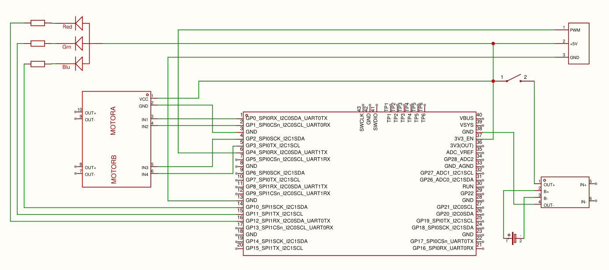

# ufsm00273-2026

Desenvolvimento do robô móvel (`r2d2_pro`) como parte da disciplina de Projeto Integrador em Engenharia de Computação I.

## Hardware

### Componentes

| Componente | Modelo |
|------------|--------|
| Microcontrolador | Raspberry Pi Pico |
| Driver de Motor | L298N |
| Motor | MDCR3-6V |
| LED | RGB  |
| Carregador de Bateria | TP4056 |
| Botão | Ativa o modo de gravação |

### Esquemático

[PDF do esquemático](hardware/esquematico.pdf)

### Pinagem

| Pico (pino) | GPIO | Conectado a | Função |
|-------------|------|-------------|--------|
| 1 | GP0 | Driver `IN1` | Motor A |
| 2 | GP1 | Driver `IN2` | Motor A |
| 4 | GP2 | Driver `IN3` | Motor B |
| 5 | GP3 | Driver `IN4` | Motor B |
| 14 | GP10 | LED Azul (`Blu`) | LED RGB |
| 15 | GP11 | LED Verde (`Grn`) | LED RGB |
| 16 | GP12 | LED Vermelho (`Red`) | LED RGB |
| 20 | GP15 | Botão | Ativa o modo de gravação |

>obs. Falta adicionar no esquemático o botão em GP15

## Funcionalidades

### API do Firmware

| Função | Descrição |
|--------|-----------|
| `MoverRodaEsquerda(velocidade)` | Move a roda esquerda (Motor A) |
| `MoverRodaDireita(velocidade)` | Move a roda direita (Motor B) |
| `LigarLed(r, g, b)` | Aciona o LED RGB |

### Comportamentos

- [x] Mover roda esquerda (frente/trás com velocidade variável)
- [x] Mover roda direita (frente/trás com velocidade variável)
- [x] Ligar LED RGB (controle de cor)
